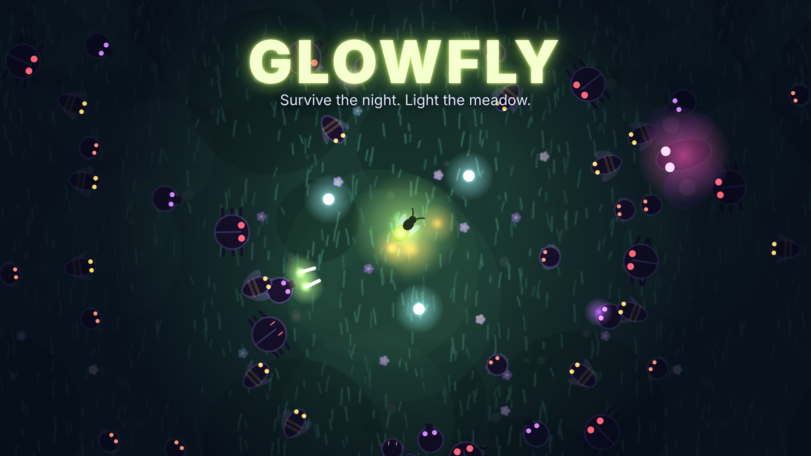

# Glowfly

Tarayıcıda oynanan, kısa oturumlu bir hayatta kalma oyunu. Çayırdaki son
ateşböceğisin; gece boyunca gölge böcekleri ışığına üşüşüyor. **Şafağa kadar
(10 dakika) dayanırsan kazanırsın.** Sen sadece uçarsın, silahların
kendiliğinden ateşlenir. Seviye atladıkça üç seçenekten birini alırsın, turlar
arasında topladığın altınla kalıcı geliştirmeler satın alırsın.



Oyun **CrazyGames ve Poki gibi oyun portallarında** yayınlanmak üzere
yapıldı. Para bu portallardan gelir: oyunu sitelerinde yayınlarlar, oyuncuyu
onlar getirir, oyunun içindeki reklamları onlar gösterir ve reklam gelirini
seninle paylaşırlar.

- Saf HTML/CSS/JavaScript; derleme adımı yok, hiçbir kütüphane yok.
- Bütün görseller ve sesler koddan üretiliyor: resim ya da ses dosyası yok,
  lisans derdi yok.
- Paketin tamamı **42 KB** (zip); portal ana sayfasında anında açılır.
- Telefonda (dokunmatik), bilgisayarda (klavye/fare) ve oyun koluyla oynanır;
  dikey ve yatay ekranda çalışır.
- İngilizce ve Türkçe; tarayıcının diline göre seçilir.

## Nasıl oynanır

| | |
|---|---|
| Uçmak | WASD / ok tuşları, ekranda herhangi bir yerden sürükleme, oyun kolu |
| Kart seçmek | tıkla ya da 1 / 2 / 3 |
| Duraklatmak | Esc ya da P |

**Silahlar** (en fazla 4): Kıvılcım, Hale, Dalga, Şimşek, Kor.
**Pasifler** (en fazla 4): Kanat, Parıltı, Kabuk, Nektar, Odak, Parlaklık,
Erişim. Her biri 5 seviye.
**Böcekler:** sinek, eşek arısı (hızlı, zikzak), böcek (sağlam), tükürgen
(uzaktan ateş eder; Dalga ve Hale mermilerini yok eder), dev güve (2:30, 5:00,
7:30) ve 8:00'de Gece Kraliçesi.

## Para nereden geliyor

Oyunun içinde iki tür reklam var. İkisini de portalın SDK'sı gösterir. Oyun
sadece "şimdi uygun" der, reklamı kendisi göstermez.

| Reklam | Ne zaman | Oyuncu ne alıyor |
|---|---|---|
| **Ara reklam** (midgame) | iki tur arasında, "Tekrar" ya da "Oyna"ya basınca. Oturumun ilk turundan önce asla | — (sıklığını portal sınırlar) |
| **Ödüllü** | oyuncu isterse: | |
| | ana menü | +60 altın (5 dakikada bir) |
| | seviye kartları | yeni üç seçenek (her seviyede bir kez) |
| | ölünce | yeniden doğ: canın %60'ı, etraf temizlenir (turda bir kez) |
| | tur sonu | o turun altınının 2 katı (turda bir kez) |

Ödüllü reklamın ödülü yalnızca reklam sonuna kadar izlenirse verilir. Reklam
oynarken oyun durur ve ses kesilir. CrazyGames'in "sesi kapat" ayarına da
uyulur. Portal SDK'sı yoksa (kendi siten, itch.io, reklam engelleyici) oyun
reklamsız çalışır ve reklam düğmeleri hiç görünmez.

**Ne kadar kazandırır?** Dürüst cevap: bilinmez. Gelir, portalın oyunu ne
kadar oyuncuya gösterdiğine bağlı ve bunu portal, oyunun ilk günlerdeki
verilerine (oynanma süresi, geri gelme oranı) bakarak belirler. Çoğu oyun az
kazanır; iyi tutan oyunlar ana sayfaya çıkar ve asıl gelir oradan gelir.
CrazyGames ödemeleri aylık yapar ve bir alt sınırı vardır (2026'daki üçüncü
taraf rehberlere göre 100 €). Gelir payı oranını sözleşmede gör.

## Portallara yükleme

```bash
cd glowfly
python3 tools/build.py      # dist/glowfly-crazygames.zip, -poki.zip, -web.zip
```

Her zip aynı oyun; tek fark `<head>` içine eklenen portal SDK'sı.

### CrazyGames (önerilen ilk adres)

1. <https://developer.crazygames.com> adresinde geliştirici hesabı aç.
2. **Yeni oyun** → HTML5 → `dist/glowfly-crazygames.zip` dosyasını yükle.
3. Portaldaki **önizleme aracında** oyunu aç ve dene: menüde "Reklam izle"
   düğmesine bas, bir tur oynayıp öl, "Tekrar"a bas. Önizleme test
   reklamları gösterir.
4. Bilgileri doldur:
   - **Ad:** Glowfly
   - **Tür:** Action / Survival (hayatta kalma); etiketler: *survivor, bullet
     heaven, roguelite, arcade, mobile*
   - **Açıklama:** aşağıdaki metni kullanabilirsin
   - **Kontroller:** "WASD / Arrow keys or drag to move. 1-2-3 to pick an
     upgrade. Esc to pause."
   - **Kapak görselleri:** `store/` klasöründe 1920×1080, 1280×720,
     800×1200, 800×800 ve 512×512 hazır. Formun istediği boyut bunlardan
     farklıysa `tools/covers.mjs` dosyasındaki listeye ekleyip
     `npm run covers` çalıştır.
5. Gönder. İnceleme genelde birkaç gün sürer. Kabul edilirse önce sınırlı bir
   kitleyle test edilir, iyi giderse daha geniş yayına çıkar.
6. Ödeme bilgilerini (vergi formu, banka) geliştirici panelinden gir.

> CrazyGames'in kendi belge sayfası (docs.crazygames.com) bu ortamdan
> açılamadı. SDK çağrıları, aynı SDK'yı kullanan güncel bir npm paketinden
> doğrulandı ve testlerde SDK'nın birebir taklidiyle denendi. Gerçek SDK ile
> ilk deneme, portalın önizleme aracında olacak.

**Örnek açıklama (EN):**
> You are the last firefly in the meadow, and the night is full of shadow-bugs
> drawn to your light. Fly, dodge, and let your light do the fighting: sparks,
> a halo of orbs, lightning that jumps from bug to bug, a trail of embers.
> Pick an upgrade each level, survive until dawn, and spend your gold on
> upgrades that last. Short runs, big swarms, one more try.

### Poki

Poki başvuruları seçerek kabul eder: <https://developers.poki.com> üzerinden
oyunu tanıtıp başvurursun, kabul ederlerse `dist/glowfly-poki.zip`
yüklenir. Poki çoğunlukla ilk yayının kendilerinde olmasını ister. Bu yüzden
önce Poki'ye başvurup cevap beklemek, sonra CrazyGames'e geçmek
düşünülebilir. Şartlarını başvururken oku.

### Diğerleri

- **GameDistribution**, **itch.io**: `dist/glowfly-web.zip` reklamsız
  sürümdür. itch.io'da "HTML" projesi olarak yükleyip bağış ya da "ne
  istersen öde" ile satabilirsin.

## Çalıştırmak ve test etmek

```bash
cd glowfly
python3 -m http.server 8000           # http://localhost:8000
# http://localhost:8000/?portal=fake  → reklamları taklit eden test modu
npm install && npm test               # 4 test paketi
```

- **sim** — oyun mantığı, tarayıcısız: aynı tohumun aynı geceyi oynaması,
  bozuk girdinin (NaN) ateşböceğini kaybetmemesi, düşman sınırı, silahlar,
  seviye seçenekleri ve slot sınırları, ölüm/yeniden doğma, şafak ve **denge**:
  geliştirmesiz bir oyuncu genelde kaybeder ama ilk dakikada değil, tam
  geliştirilmiş oyuncu genelde şafağı görür.
- **game** — gerçek sayfada bütün akış ve her ödüllü reklam: yarıda kalan
  reklam ödül vermez, yeniden doğan turun altını iki kez ödenmez ve tek tur
  sayılır, turlar arasında ara reklam, kayıtların yeniden yüklemede kalması,
  Türkçe.
- **portals** — CrazyGames v3 ve Poki v2 SDK'larının birebir taklitleriyle
  doğru çağrıların doğru sırada yapılması, reklam sırasında sesin kesilmesi,
  portalın sessiz ayarı, reklam engelleyici SDK'yı engellese de oyunun
  açılması.
- **layout** — küçük telefondan masaüstüne altı ekran boyutunda her ekranın,
  bütün reklam düğmeleri açıkken sığması.

## Dosyalar

```
index.html        tek sayfa; <!-- PORTAL_SDK --> yerine SDK eklenir
css/style.css
js/
  config.js       bütün ayar sayıları: düşmanlar, dalgalar, silahlar, mağaza, reklam ödülleri
  run.js          gecenin simülasyonu (DOM'suz, test edilebilir)
  render.js       çizim: çayır, karanlık katmanı, ışıklar
  portal.js       CrazyGames / Poki / test / hiçbiri
  main.js         durum makinesi, döngü, reklam akışları
  ui.js input.js audio.js save.js i18n.js icons.js rng.js
tools/build.py    portal başına zip
tools/covers.mjs  kapak görselleri (oyunun kendisinden)
store/            hazır kapaklar ve ikon
tests/            yukarıdaki dört paket
```

Bütün sayılar `js/config.js` dosyasında: oyunu zorlaştırmak ya da
kolaylaştırmak, mağaza fiyatlarını ya da reklam ödüllerini değiştirmek için
tek bakılacak yer orası. Değiştirdikten sonra `npm test`, dengenin hâlâ
makul olup olmadığını söyler.
