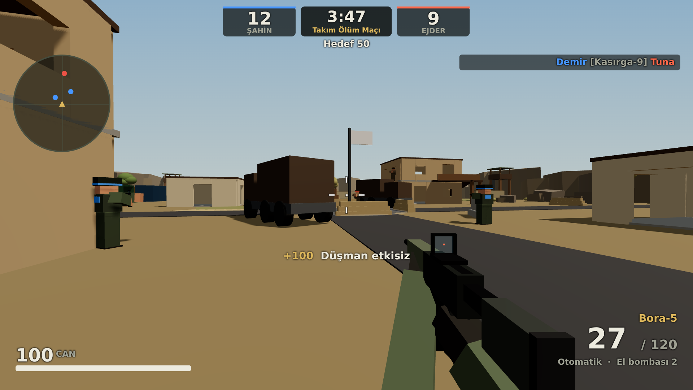
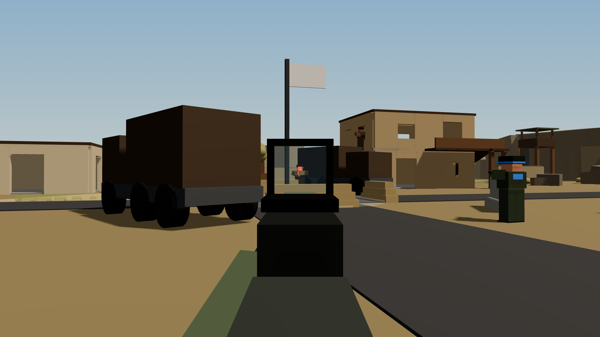
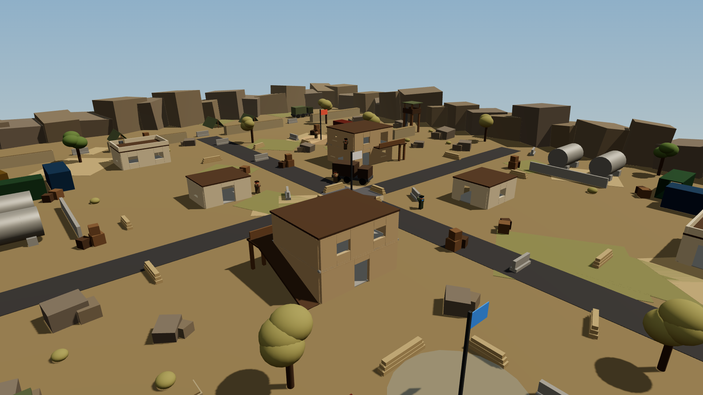
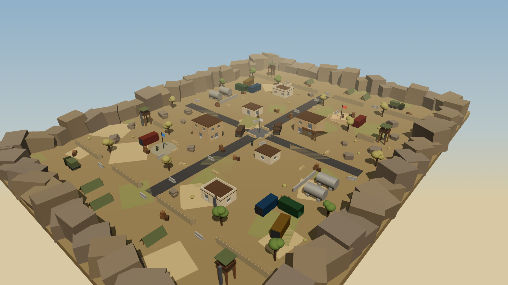
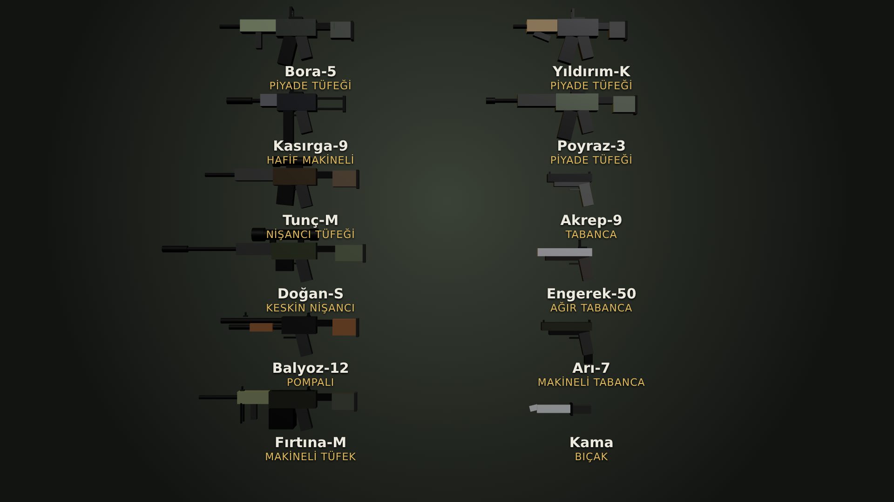

# Bozkır Harekâtı (Roblox)

Roblox için birinci şahıs askerî nişancı oyunu. İki birlik (Şahin ve Ejder),
bir bozkır karakolu haritası, üç oyun modu, on bir silah ve bir bıçak,
eklentiler, rütbeler ve oyuncu az olduğunda takımları dolduran botlar var.
Harita, silahlar ve askerler tamamen koddan, Roblox parçalarından kuruluyor;
hazır model kullanılmadı.



| | |
|---|---|
|  |  |
|  |  |

> **Bu resimler hakkında:** Roblox Studio'dan alınmış ekran görüntüleri
> değiller. Haritayı, askerleri ve silahları oyunun kendi kodu kuruyor, her
> parçanın konumu, boyutu ve rengi oyundakiyle aynı. Ama resimleri Roblox
> değil tarayıcı (three.js) çizdi. Roblox'ta ışık, gölge, sis ve malzeme
> dokuları (kum, beton, tahta, metal) farklı görünecek. HUD da oyundaki
> yerleşime göre ayrıca çizildi; yazı tipi farklı. Nasıl üretildiği aşağıda.

## Neye bakarak yapıldı

Roblox'taki popüler askerî nişancı oyunlarına baktım; Phantom Forces,
Bad Business, Arsenal, RIVALS, FRONTLINES ve Military Combat Tycoon gibi.
Bu türde oyuncuyu tutan şeyler hep aynıydı:

- **Her silahın kendine has hissi.** Ayrı tepme, atış hızı ve hasar düşüşü.
  Burada her silahın dikey/yatay tepmesi, dağılması ve menzili ayrı ayarlı.
- **Silah başına eklenti ağacı.** Phantom Forces'ta eklentiler o silahla
  alınan leşlerle açılıyor ve her eklentinin bir bedeli var. Burada da öyle:
  kompansatör dikey tepmeyi azaltır ama yatayı artırır, dürbün yakınlaştırır
  ama nişanı yavaşlatır.
- **Rütbeyle açılan silahlar.** Uzun süreli ilerleme duygusu buradan geliyor.
- **Mod çeşitliliği.** Takım Ölüm Maçı, bölge tutma ve Arsenal'deki gibi
  herkesin tek başına olduğu, her leşte silahın değiştiği bir mod.

Oyunun adı, haritası ve silahları özgün. Hiçbir oyunun içeriği kopyalanmadı.

Kaynaklar: [Phantom Forces ve rakipleri](https://www.lootbar.com/blog/en/best-roblox-fps-games.html),
[en iyi askerî oyunlar](https://sportskeeda.com/esports/top-5-best-roblox-military-games),
[eklentiler ve rütbeler](https://sportskeeda.com/roblox-news/top-3-reasons-phantom-forces-best-game-roblox),
[FPS türleri karşılaştırması](https://dungeonpath.com/posts/pillar/roblox-fps-games-compared/),
[RIVALS'ın tepme ayarı](https://rolearn.dev/case-studies/fps-rivals-competitive-shooter-growth).

## Oyun

### Modlar (sırayla döner)

| Mod | Kural |
|---|---|
| **Takım Ölüm Maçı** | 50 leşe ilk ulaşan takım kazanır (8 dakika). |
| **Bölge Hakimiyeti** | A, B ve C bölgelerini al ve tut. Elde tutulan her bölge 3 saniyede 1 puan getirir. 150 puana ilk ulaşan takım kazanır. |
| **Silah Yarışı** | Herkes tek başına. Her leş bir sonraki silahı verir (12 seviye), son silah bıçak. Bıçaklanan bir seviye geri düşer. |

Turlar arasında 15 saniye mola var. Her turda hava değişiyor: öğle, gün
batımı ya da sabah sisi.

### Silahlar

| Silah | Tür | Açılış | Not |
|---|---|---|---|
| Bora-5 | Piyade tüfeği | başta | Her mesafede dengeli |
| Kasırga-9 | Hafif makineli | başta | Yakında çok hızlı |
| Tunç-M | Nişancı tüfeği | rütbe 3 | Yarı otomatik |
| Doğan-S | Keskin nişancı | rütbe 4 | Kafadan tek atış, dürbünlü |
| Balyoz-12 | Pompalı | rütbe 5 | Sekiz saçma |
| Fırtına-M | Makineli tüfek | rütbe 7 | 80'lik şerit, ağır |
| Yıldırım-K | Piyade tüfeği | rütbe 9 | Kısa namlu, sert tepme |
| Poyraz-3 | Piyade tüfeği | rütbe 11 | Üçlü atış |
| Akrep-9 | Tabanca | başta | |
| Engerek-50 | Ağır tabanca | rütbe 6 | |
| Arı-7 | Makineli tabanca | rütbe 10 | |
| Kama | Bıçak | başta | Tek vuruş |

Testler her silah için 10 metrede kaç gövde/kafa isabetinin öldürdüğünü ve
öldürme süresini yazdırıyor (`tests/shared.test.luau`). Dengeyi oradan
izleyebilirsin.

**Eklentiler** (nişangâh, namlu, kabza, şarjör): kırmızı nokta, holografik,
4x dürbün, susturucu (radarda görünmezsin), kompansatör, uzun namlu, dikey
ve açılı kabza, lazer, uzatılmış ve hızlı şarjör. Her eklenti o silahla
belirli sayıda leş alınca açılıyor. Her sınıf her eklentiyi takamıyor; örneğin
keskin nişancıya kırmızı nokta takılmıyor.

**Rütbeler:** Er'den Mareşal'e 19 rütbe. Puan leş (100), kafadan vuruş (+50),
asist, uzak atış, intikam, seri, bölge alma ve tur sonucundan geliyor.
İlerleme Roblox DataStore'a kaydediliyor.

### Savaş

- Nişan alma (görüş daralır, fare yavaşlar), koşma, eğilme, koşarken
  eğilince kayma.
- Tepme kamerayı kaldırır; ateş kesilince bir kısmı geri gelir. Yürürken,
  zıplarken ve seri atışta dağılma artar, eğilince azalır.
- Kafa, gövde ve uzuvlar farklı hasar alır. Mesafe arttıkça hasar düşer.
- El bombası (2 adet), hızlı bıçak (silah elindeyken V).
- Can, hasar almadan 5 saniye geçince dolmaya başlar. Sahaya inişte 3 saniye
  koruma kalkanı var (ateş edince kalkar).
- Radar: takım arkadaşları hep görünür. Düşman, susturucusuz ateş edince
  2,5 saniye görünür.
- Hasar yön göstergesi, isabet işareti (öldürünce kırmızı, kafadan sarı),
  öldürme akışı, puan bildirimleri, rütbe atlama afişi, skor tablosu.

### Botlar

Sunucu boşken de çatışma olsun diye her takım 5 kişiye (Silah Yarışı'nda
toplam 8 kişiye) kadar botla dolduruluyor. Oyuncu geldikçe botlar çıkıyor.
Botlar yol buluyor, gördükleri düşmana kısa bir tepki süresiyle dönüp
salvolar hâlinde ateş ediyor, vurulunca saldırganı arıyor ve bölge
modunda bölgelere gidiyor. Ayarı `Config.FillPerTeam` ile değişir; 0
yaparsan bot olmaz.

### Hile koruması

Vuruşu oyuncunun ekranı belirler ama sunucu her atışı denetler: silah
gerçekten o oyuncuda mı, şarjörde mermi var mı, atış hızı mümkün mü, atış
oyuncunun başından mı çıkıyor, hedef söylenen yerde mi, arada duvar var mı.
Teçhizat isteğinde kilitli silah ya da eklenti varsa sunucu onu atar.

## Kontroller

| | Klavye ve fare | Oyun kolu | Telefon |
|---|---|---|---|
| Ateş | Sol tık | RT | ATEŞ (iki tane: sağda ve solda) |
| Nişan | Sağ tık (basılı) | LT | NİŞAN (aç/kapa) |
| Doldur | R | X | DOLDUR |
| Silah | 1 / 2 / 3, tekerlek, Q (önceki) | Y | SİLAH |
| El bombası | G | RB | BOMBA |
| Bıçak | V ya da F | R3 | BIÇAK |
| Koş | Shift (basılı) | L3 | KOŞ |
| Eğil / kay | C ya da Ctrl | B | EĞİL |
| Skor tablosu | Tab (basılı) | Select | SKOR |
| Savaşa katıl | Enter | Start | düğme |

Ekranlar 1024×600'e göre tasarlandı ve her ekrana orantılı ölçekleniyor.
Telefonda can ve cephane göstergeleri yukarı taşınıyor, çünkü alt köşeler
yürüme çubuğuna ve düğmelere ayrılıyor.

## Roblox Studio'da açmak

### En kolayı: hazır yer dosyası

1. [Roblox Studio](https://create.roblox.com/)'yu kur (Windows ya da Mac).
2. **File → Open from File** ile `roblox/BozkirHarekati.rbxl` dosyasını aç.
3. **Play** (F5) ile tek başına dene. Botlar takımları doldurur.
   Birden çok oyuncuyla denemek için **Test** sekmesinde oyuncu sayısını
   seçip **Start**'a bas.

Studio'da ilerlemenin kaydedilmesi için: **Game Settings → Security → Enable
Studio Access to API Services**. Kapalıysa oyun yine çalışır, yalnızca
ilerleme o oturumda kalır (Output'ta bir uyarı görürsün).

### Yayımlamak

1. **File → Publish to Roblox** ile oyunu yayımla.
2. **Game Settings → Avatar** altında avatar türünü **R15** yap. Askerin
   silah tutuşu R15'e göre ayarlı.
3. **Game Settings → Permissions** altından oyunu herkese aç.

### Kodla çalışmak (Rojo)

Kaynak kod `src/` altında. Yer dosyası [Rojo](https://rojo.space) ile
derleniyor:

```bash
cd roblox
rokit install                 # rojo, lune, selene, stylua (rokit.toml)
rojo serve                    # Studio'daki Rojo eklentisiyle canlı eşitleme
rojo build -o BozkirHarekati.rbxl
```

Kod değişince `BozkirHarekati.rbxl`'i yeniden derlemeyi unutma
(`tools/check.sh build`).

## Ayarlar

| Dosya | Ne var |
|---|---|
| `src/shared/Config.luau` | Can, hız, tur süreleri, bot sayısı, el bombası, puanlar |
| `src/shared/Weapons.luau` | Silahların bütün sayıları |
| `src/shared/Attachments.luau` | Eklentiler, açılma leşleri, hangi sınıfa uyduğu |
| `src/shared/Modes.luau` | Modlar, süreler, hedefler, Silah Yarışı sırası |
| `src/shared/Ranks.luau` | Rütbe adları ve eşikleri |
| `src/shared/Sounds.luau` | Ses kimlikleri |
| `src/server/MapBuilder.luau` | Harita ve hava ön ayarları |

### Sesler: değiştirilmesi gerekiyor

`Sounds.luau`'daki sesler Roblox'un kendi içinde gelen eski dosyalara
(`rbxasset://sounds/...`) işaret ediyor. Bu dosyaların hepsinin her Roblox
sürümünde bulunduğunu doğrulayamadım. Ayrıca silah sesi olarak zayıflar.
Yüklenemeyen ses oyunu bozmaz, yalnızca sessiz kalır. İyi silah sesleri için
Studio'da **Toolbox → Audio** (Creator Store) içinden ücretsiz bir ses seç,
kimliğini (`rbxassetid://...`) `Sounds.luau`'da ilgili satıra yaz.

## Klasörler

```
roblox/
  default.project.json   Rojo projesi (servisler, uzak olaylar, oyuncu ayarları)
  BozkirHarekati.rbxl    Studio'da açılan hazır yer dosyası (derlenmiş)
  src/shared/            Sunucu ve istemcinin ortak kodu: silahlar, balistik, modeller
  src/server/            Harita, turlar, çatışma, botlar, kayıt
  src/client/            Birinci şahıs görünüm, silah denetimi, hareket, HUD, menü
  src/character/         Varsayılan can yenilemeyi kapatan boş betik
  tests/                 Lune ile çalışan testler
  tools/                 Denetim betikleri ve önizleme üretici
  docs/                  Önizleme resimleri
```

## Testler

```bash
cd roblox
tools/check.sh
```

Bu komut sırayla şunları yapıyor:

1. Yer dosyasını Rojo ile derler.
2. Biçimi stylua ile, sözdizimini Luau derleyicisiyle denetler.
3. Koddaki her Roblox adını (özellik, yöntem, olay, Enum) Roblox'un resmî
   API listesine karşı denetler. `BackgroundTransparancy` gibi bir yazım
   hatası Studio'ya girmeden yakalanır. Ardından selene çalışır.
4. Testleri çalıştırır. Testler [Lune](https://lune-org.github.io/docs) ile
   derlenmiş yer dosyasını açıyor ve oyunun asıl kodunu çalıştırıyor. Lune
   her nesneyi gerçekten kuruyor ve her özellik adını ve türünü denetliyor.
   - `shared`: silah tanımları, eklentiler, rütbeler, teçhizat doğrulama,
     balistik, bütün silah×eklenti modelleri (96 adet), denge tablosu ve
     haritada doğuş noktalarının ve bölgelerin bir nesnenin içine düşmediği.
   - `server`: bir oyuncu bağlanır; tur akışı, botların doğup ateş etmesi,
     sahte atışların reddi, kafa/gövde hasarı, leş, puan ve rütbe, atış hızı
     sınırı, dolum, bıçak, el bombası, tur sonu, bölge ele geçirme, Silah
     Yarışı'nda seviye atlama ve ayrılınca kayıt.
   - `client`: menü, kilitli/açık silah ve eklenti seçimi, sahaya iniş, silah
     görünümü, otomatik ateş, nişan, dolum, silah değiştirme, bıçak, el
     bombası, koşma/kayma/eğilme, HUD mesajları, radar ve isim etiketleri,
     skor tablosu, dokunmatik düğmeler, ölüm ekranı ve tur sonucu.

Testlerin göremediği şeyler var: fizik (karakterler testte yürümüyor, bu
yüzden botların yol bulması sınanmıyor), Roblox'un gerçek görüntüsü ve
sesi, fare hissi. Bunlar için oyunu Studio'da oynamak gerekiyor.

## Önizleme resimleri

`docs/` altındaki resimler şöyle üretiliyor:

```bash
lune run tools/preview/export.luau BozkirHarekati.rbxl build/scene.json
# build/ içine three@0.160.0'ı kur (npm install three@0.160.0), render.html'i kopyala, sonra:
node tools/preview/shoot.cjs build docs
```

`export.luau` haritayı, askerleri, silah görünümünü ve silah dizisini oyunun
kendi modülleriyle kurup her parçayı JSON'a yazıyor. `render.html` bunları
three.js ile çiziyor. HUD katmanı `src/client/Hud.luau`'daki konumlarla
elle çizildi.
